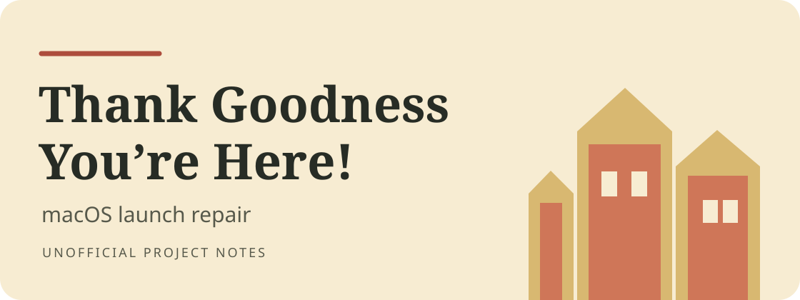
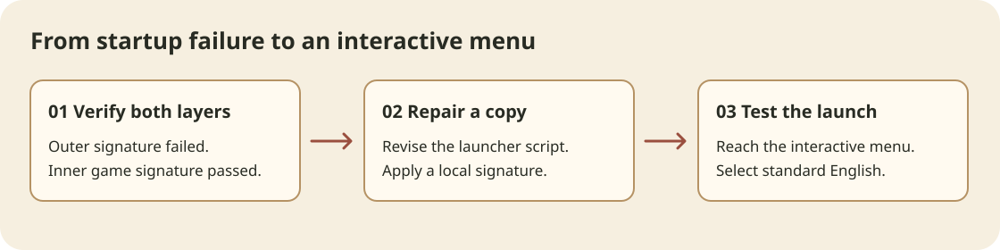

# Thank Goodness You're Here! — macOS launch repair

一个针对特定第三方 macOS 安装包的启动修复记录。原安装包弹出 “is damaged and can’t be opened”。修复副本已在 Apple silicon Mac 上启动到交互菜单，并切换为标准英语。游戏由 Coal Supper 开发、Panic 发行，本仓库是独立的维修记录。

An unofficial repair record for a specific macOS package that showed “is damaged and can’t be opened.” The repaired copy reached the interactive menu on an Apple silicon Mac. The menu and subtitle language was set to standard English.

## 故障原因 / What failed

The original disk image passed its checksum. macOS rejected the outer third-party launcher because its files did not match the signature. The nested game passed signature and notarization checks. A direct launch of the nested app reached the Unity splash screen and then exited after Steamworks requested a restart through Steam.

## 修复过程 / What changed

- Worked on a separate copy of the application.
- Revised the launcher so it starts and cleans up its own helper process, without stopping unrelated Steam services.
- Applied a local ad hoc signature to the outer bundle and verified both layers. The inner game's developer signature was preserved.
- Allowed the repaired copy to launch locally and confirmed it reached the first interactive screen.
- Changed **Options → Language** from **Dialect** to **English** and confirmed **Continue** and **Options** appeared in the menu.

Steam integration reported an initialization error during the test. Steam features such as achievements may be unavailable. The local signature does not confer Apple notarization on the outer launcher.

## 版本 / Release

See [Releases](../../releases) for any available build. The planned macOS ZIP is approximately 737 MB.

Game and publisher information is available on the [official game website](https://thankgoodness.game/).
